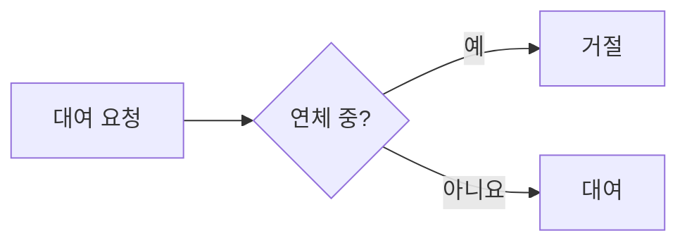

# 도서 대여 API — 연체 회원 대여 금지 규칙을 테스트로 고정하기

도서관 실습에서 "연체 중인 회원은 빌릴 수 없다" 규칙을 구현했습니다. 처음 구현은 화면에서는 잘 동작했지만 테스트를 붙이자 경계값에서 실패했습니다.

<!-- more -->

## 1. 문제

반납 예정일 당일에 반납하지 않은 회원이 대여에 성공했습니다.

## 2. 원인

```java
if (member.overdueDays() > 0) {
    throw new LoanNotAllowedException(member.id());
}
```

연체일 계산이 날짜 차이를 내림해서 당일 연체가 0일로 계산됐습니다.

## 3. 해결과 검증




- 수정 커밋: [a1b2c3d](https://github.com/gildong/spring-library/commit/a1b2c3d)
- [x] 경계값 테스트 3건 추가
- [ ] 반납 기능은 다음 글에서

!!! note "배운 점"
    규칙은 테스트 이름으로 먼저 적고 구현합니다.
